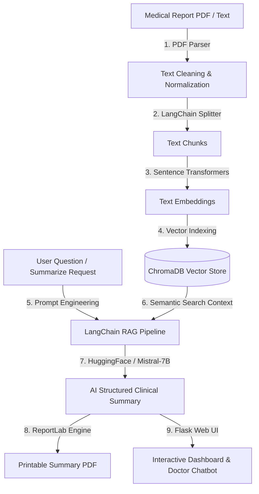

# AI-Powered Medical Report Summarization System 🏥🤖

[](https://www.python.org/)
[](https://flask.palletsprojects.com/)
[](https://www.langchain.com/)
[](https://www.trychroma.com/)
[](https://huggingface.co/mistralai/Mistral-7B-Instruct-v0.2)
[](LICENSE)

An enterprise-grade, full-stack **Medical Report Summarization & Clinical Decision Support System** built using **Python, Flask, MongoDB (with SQLite fallback), LangChain, ChromaDB, and HuggingFace (Mistral-7B)** to extract, vectorize, and generate structured clinical summaries from complex medical PDF reports.

---

## 🌐 Quick Access & Live Demo Link

When the server is running locally on your system, access the web application directly at:

👉 **[http://localhost:5000](http://localhost:5000)** or **[http://127.0.0.1:5000](http://127.0.0.1:5000)**

### 🔑 Default Doctor Credentials:
| Portal | Username | Password |
|---|---|---|
| **Chief Medical Officer** | `doctor` | `doctor123` |

*(You can also register a new clinical account on the `/register` portal).*

> **💡 Always-Active Local Run**: Double-click [`run_app.bat`](run_app.bat) in the repository folder to instantly launch the server anytime!

---

## 📌 Project Overview

Medical reports (such as Cardiology evaluations, MRI scans, Pathology tests, and Discharge summaries) are dense, technical, and time-consuming for clinicians to review quickly. This system leverages **Generative AI (GenAI)** and **Retrieval Augmented Generation (RAG)** to automatically parse medical documents, index them into a high-performance vector store, and extract key diagnostic insights into structured clinical briefings.

### 🌟 Key Highlights
- **Mistral-7B AI Summaries**: Uses HuggingFace's `Mistral-7B-Instruct` LLM to generate narrative summaries (Executive Brief, Clinical Impressions, Medications, Warnings, Recommendations).
- **Zero-Crash Resilient Architecture**: Automatically falls back to deterministic rule-based NLP extraction if no HuggingFace token is provided or if network calls are unavailable.
- **RAG-Powered Interactive Q&A**: Allows doctors and patients to ask natural language questions grounded strictly in the uploaded medical report context.
- **Downloadable Clinical PDF Reports**: Generates formatted, printable medical PDF summaries equipped with hospital headers, vital sign tables, doctor signature blocks, and dynamic generation source attribution.
- **Dual Database Architecture**: Native MongoDB support with automatic, zero-configuration SQLite fallback for seamless execution in any environment.

---

## 🏗️ System Architecture



---

## 🛠️ Tech Stack & Key Technologies

| Category | Technology Used | Description |
|---|---|---|
| **Backend Framework** | Python 3.10+, Flask | Web routing, session management, REST APIs |
| **Generative AI Model** | Mistral-7B-Instruct / HuggingFace | Medical text generation & Prompt Engineering |
| **RAG Orchestration** | LangChain | Text chunking, prompt pipelines, RAG retrieval |
| **Vector Database** | ChromaDB | High-dimensional vector embedding storage & semantic search |
| **Embeddings Model** | HuggingFace (`all-MiniLM-L6-v2`) | Text-to-Vector embeddings generation |
| **Databases** | MongoDB & SQLite | User profiles, patient records, and summary persistence |
| **PDF Generation** | ReportLab | Exporting formatted clinical PDF memos |
| **Frontend UI** | HTML5, Modern CSS Glassmorphic Theme, JS | Responsive dark-mode dashboard & chat UI |

---

## 🚀 Key Modules Implemented

1. **User Authentication Module**: Secure Doctor/Staff Signup, Login, and Role-Based Session Management.
2. **Patient Management Module**: Complete Patient CRUD directory (Patient Code, Name, Age, Gender, Blood Group, Pre-existing History).
3. **PDF Report Upload & Processing**: Drag-and-drop PDF reader with automated NLP text extraction.
4. **Vectorstore & Semantic Search**: Automated chunking via `RecursiveCharacterTextSplitter` and indexing into ChromaDB.
5. **AI Summarization Engine**: Mistral-7B prompt engineering targeting diagnoses, vitals, prescriptions, and warnings with deterministic rule-based fallback.
6. **Contextual Q&A Assistant**: Real-time RAG chatbot allowing users to ask questions grounded strictly in report context.
7. **PDF Summary Exporter**: Instant downloadable, printable clinical summary report with hospital letterhead styling and true source attribution.

---

## 📂 Repository Directory Structure

```
medical-report-summarization/
│
├── app.py                     # Main Flask web application & API routes
├── config.py                  # Environment & app configuration settings
├── models.py                  # Database abstraction (MongoDB + SQLite fallback)
├── rag_engine.py              # LangChain + ChromaDB + Mistral-7B LLM client & RAG pipeline
├── pdf_generator.py           # ReportLab PDF summary generation utility
├── create_sample_pdfs.py      # Script to generate sample medical PDFs for testing
├── test_llm_integration.py    # Unit tests for LLM integration & fallback mechanisms
├── requirements.txt           # Python dependencies list
├── .env.example               # Environment variables template
├── .gitignore                 # Excluded git build files & local database entries
├── run_app.bat                # 1-click portable Windows application launcher
├── LICENSE                    # MIT Open Source License
├── README.md                  # Detailed project documentation
│
├── templates/                 # Jinja2 HTML5 Templates
│   ├── base.html              # Layout shell & responsive navigation
│   ├── login.html             # User authentication login
│   ├── register.html          # Staff registration form
│   ├── dashboard.html         # Main metrics & report overview dashboard
│   ├── patients.html          # Patient management system & modal
│   ├── upload_report.html     # PDF document drag-and-drop uploader
│   └── report_detail.html     # Structured summary view & RAG Chatbot UI
│
├── static/                    # Front-end Static Assets
│   ├── css/
│   │   └── styles.css         # Custom modern glassmorphism dark theme
│   └── js/
│       └── main.js            # Interactivity for file uploads, loaders, & chat API
│
└── uploads/                   # Uploaded medical PDF documents directory
```

---

## 🔧 Step-by-Step Installation & Setup Guide

### Step 1: Clone the Repository
```bash
git clone https://github.com/PatanNayeem/medical-report-summarization.git
cd medical-report-summarization
```

### Step 2: Create a Virtual Environment (Recommended)
- **On Windows (PowerShell / Command Prompt)**:
  ```bash
  python -m venv venv
  .\venv\Scripts\activate
  ```
- **On Linux / macOS**:
  ```bash
  python3 -m venv venv
  source venv/bin/activate
  ```

### Step 3: Install Dependencies
```bash
pip install -r requirements.txt
```

### Step 4: Configure Environment Variables (Optional)
Copy the `.env.example` file to `.env`:
```bash
cp .env.example .env
```
To enable live Mistral-7B API generation, add your HuggingFace API Token:
```env
HUGGINGFACE_API_TOKEN=hf_your_token_here
MODEL_ID=mistralai/Mistral-7B-Instruct-v0.2
```
*(If no token is supplied, the app automatically runs in rule-based NLP mode with zero crashes).*

### Step 5: Run the Verification Tests
```bash
python test_llm_integration.py
```
Expected output:
```text
PASS 1 fallback when no token
PASS 2 LLM output merged
PASS 3 bad output handled
PASS 4 Q&A with LLM and fallback
PASS 5 PDF footer
ALL TESTS PASSED
```

### Step 6: Start the Application
- **Direct Command**:
  ```bash
  python app.py
  ```
- **Or on Windows (1-Click)**: Double-click `run_app.bat`

### Step 7: Open the Application
Open your browser and navigate to:
👉 **[http://localhost:5000](http://localhost:5000)**

---

## 📖 Step-by-Step User Workflow

1. **Log In**: Sign in using `doctor` / `doctor123` or register a new staff account.
2. **Add a Patient**: Navigate to **Patients** -> Click **Add New Patient** -> Enter patient details.
3. **Upload Report**: Click **Upload Report** -> Select the patient -> Drag and drop a medical PDF file or paste doctor notes.
4. **View AI Summary**: The system processes the document through ChromaDB & Mistral-7B, rendering a structured summary with vital sign cards and risk indicators.
5. **Ask RAG Assistant**: Use the **Ask Doctor AI** chat box to query specific medical details (e.g., *"What medications were prescribed?"*).
6. **Download Summary PDF**: Click **Download Summary PDF** to save a printable clinical PDF memo.

---

## ☁️ Deploying Live Online 24/7 (Free Hosting Options)

To keep the application accessible live to anyone on the web at all times:

1. **Render (Recommended Free Web Service)**:
   - Create an account on [render.com](https://render.com).
   - Click **New** -> **Web Service** -> Connect this GitHub repository (`PatanNayeem/medical-report-summarization`).
   - Set Build Command: `pip install -r requirements.txt`
   - Set Start Command: `gunicorn app:app` (or `python app.py`)
   - Add Environment Variables (`SECRET_KEY`, `HUGGINGFACE_API_TOKEN`).

2. **Hugging Face Spaces**:
   - Create a new Space on [huggingface.co/spaces](https://huggingface.co/spaces) with SDK set to **Docker** or **Gradio/Flask**.
   - Sync this repository to provide instant public access.

---

## 🤝 Contributing

Contributions, issues, and feature requests are welcome! Feel free to check the [issues page](https://github.com/PatanNayeem/medical-report-summarization/issues).

---

## 📜 License

Distributed under the MIT License. See [`LICENSE`](LICENSE) for details.
