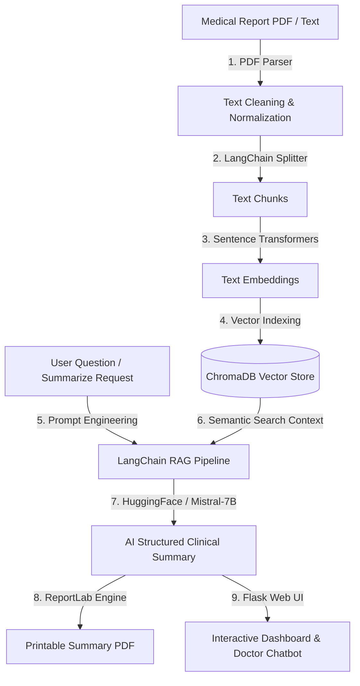

# AI-Powered Medical Report Summarization System 🏥🤖

[](https://www.python.org/)
[](https://flask.palletsprojects.com/)
[](https://www.langchain.com/)
[](https://www.trychroma.com/)
[](https://huggingface.co/mistralai/Mistral-7B-Instruct-v0.2)
[](LICENSE)

An enterprise-grade, full-stack **Medical Report Summarization & Clinical Decision Support System** built using **Python, Flask, MongoDB (with SQLite fallback), LangChain, ChromaDB, and HuggingFace (Mistral-7B)** to extract, vectorize, and generate structured clinical summaries from complex medical PDF reports.

---

## 📌 Project Overview

Medical reports (such as Cardiology evaluations, MRI scans, Pathology tests, and Discharge summaries) are dense, technical, and time-consuming for clinicians to review quickly. This system leverages **Generative AI (GenAI)** and **Retrieval Augmented Generation (RAG)** to automatically parse medical documents, index them into a high-performance vector store, and extract key diagnostic insights into structured clinical briefings.

### 🌟 Key Highlights
- **Structured Clinical Summaries**: Automatically parses complex text into 5 core clinical dimensions: Executive Brief, Clinical Impression/Diagnosis, Vital Signs & Lab Parameters, Treatment Plan, and Critical Warnings.
- **RAG-Powered Interactive Q&A**: Allows doctors and patients to ask natural language questions grounded specifically in the uploaded report context.
- **Downloadable Clinical PDF Reports**: Generates formatted, printable medical PDF summaries equipped with hospital headers, vital sign tables, and doctor signature blocks.
- **Dual Database Architecture**: Native MongoDB support with automatic, zero-configuration SQLite fallback for seamless execution in any environment.

---

## 🏗️ System Architecture



---

## 🛠️ Tech Stack & Key Technologies

| Category | Technology Used | Description |
|---|---|---|
| **Backend Framework** | Python 3.10+, Flask | Web routing, session management, REST APIs |
| **Generative AI Model** | Mistral-7B / HuggingFace | Medical text generation & Prompt Engineering |
| **RAG Orchestration** | LangChain | Text chunking, prompt pipelines, RAG retrieval |
| **Vector Database** | ChromaDB | High-dimensional vector embedding storage & semantic search |
| **Embeddings Model** | HuggingFace (`all-MiniLM-L6-v2`) | Text-to-Vector embeddings generation |
| **Databases** | MongoDB & SQLite | User profiles, patient records, and summary persistence |
| **PDF Generation** | ReportLab | Exporting formatted clinical PDF memos |
| **Frontend UI** | HTML5, Modern CSS Glassmorphic Theme, JS | Responsive dark-mode dashboard & chat UI |

---

## 🚀 Key Modules Implemented

1. **User Authentication Module**: Secure Doctor/Staff Signup, Login, and Role-Based Session Management.
2. **Patient Management Module**: Complete Patient CRUD directory (Patient Code, Name, Age, Gender, Blood Group, Pre-existing History).
3. **PDF Report Upload & Processing**: Drag-and-drop PDF reader with automated NLP text extraction.
4. **Vectorstore & Semantic Search**: Automated chunking via `RecursiveCharacterTextSplitter` and indexing into ChromaDB.
5. **AI Summarization Engine**: Structured prompt engineering targeting diagnoses, vitals, prescriptions, and warnings.
6. **Contextual Q&A Assistant**: Real-time RAG chatbot allowing users to ask questions grounded in report context.
7. **PDF Summary Exporter**: Instant downloadable, printable clinical summary report with hospital letterhead styling.

---

## 📂 Repository Directory Structure

```
medical_report_summarizer/
│
├── app.py                     # Main Flask web application & API routes
├── config.py                  # Environment & app configuration settings
├── models.py                  # Database abstraction (MongoDB + SQLite fallback)
├── rag_engine.py              # LangChain + ChromaDB + HuggingFace RAG pipeline
├── pdf_generator.py           # ReportLab PDF summary generation utility
├── create_sample_pdfs.py      # Script to generate sample medical PDFs for testing
├── requirements.txt           # Python dependencies list
├── .gitignore                 # Excluded git build files & local database entries
├── README.md                  # Detailed project documentation
│
├── templates/                 # Jinja2 HTML5 Templates
│   ├── base.html              # Layout shell & responsive navigation
│   ├── login.html             # User authentication login
│   ├── register.html          # Staff registration form
│   ├── dashboard.html         # Main metrics & report overview dashboard
│   ├── patients.html          # Patient management system & modal
│   ├── upload_report.html     # PDF document drag-and-drop uploader
│   └── report_detail.html     # Structured summary view & RAG Chatbot UI
│
├── static/                    # Front-end Static Assets
│   ├── css/
│   │   └── styles.css         # Custom modern glassmorphism dark theme
│   └── js/
│       └── main.js            # Interactivity for file uploads, loaders, & chat API
│
└── uploads/                   # Uploaded medical PDF documents directory
```

---

## 🔧 Step-by-Step Installation & Setup Guide

Follow these step-by-step instructions to clone, set up, and run the project locally.

### Step 1: Clone the Repository
```bash
git clone https://github.com/YOUR_USERNAME/medical-report-summarizer.git
cd medical-report-summarizer
```

### Step 2: Create a Virtual Environment (Recommended)
- **On Windows (PowerShell / Command Prompt)**:
  ```bash
  python -m venv venv
  .\venv\Scripts\activate
  ```
- **On Linux / macOS**:
  ```bash
  python3 -m venv venv
  source venv/bin/activate
  ```

### Step 3: Install Dependencies
```bash
pip install -r requirements.txt
```

### Step 4: Generate Demo Test Data (Optional)
Run the built-in generator script to create sample medical PDF reports in the `uploads/` directory:
```bash
python create_sample_pdfs.py
```

### Step 5: Run the Flask Web Server
```bash
python app.py
```

### Step 6: Open the Application
Navigate to `http://127.0.0.1:5000` in your web browser.

---

## 🔑 Demo Login Credentials

The system comes pre-seeded with a default doctor account for instant testing:

| Role | Username | Password |
|---|---|---|
| **Chief Medical Officer** | `doctor` | `doctor123` |

*(You can also register a new account on the `/register` page).*

---

## 📖 Step-by-Step User Workflow

1. **Log In**: Sign in using `doctor` / `doctor123` or register a new staff account.
2. **Add a Patient**: Navigate to **Patients** -> Click **Add New Patient** -> Enter patient details.
3. **Upload Report**: Click **Upload Report** -> Select the patient -> Drag and drop a medical PDF file or paste doctor notes.
4. **View AI Summary**: The system processes the document through ChromaDB & Mistral-7B, rendering a structured summary with vital sign cards and risk indicators.
5. **Ask RAG Assistant**: Use the **Ask Doctor AI** chat box to query specific medical details (e.g., *"What medications were prescribed?"*).
6. **Download Summary PDF**: Click **Download Summary PDF** to save a printable clinical PDF memo.

---

## 🤝 Contributing

Contributions, issues, and feature requests are welcome! Feel free to check the [issues page](https://github.com/YOUR_USERNAME/medical-report-summarizer/issues).

---

## 📜 License

Distributed under the MIT License. See `LICENSE` for details.
